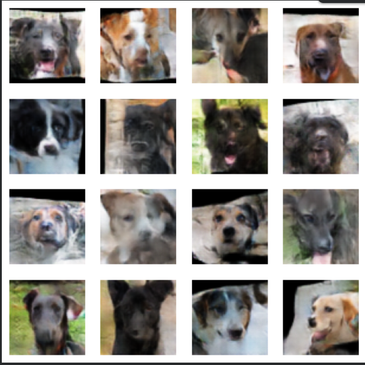
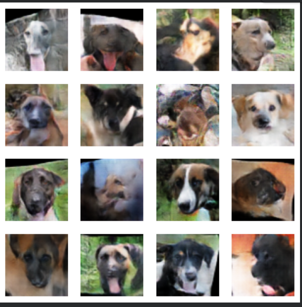
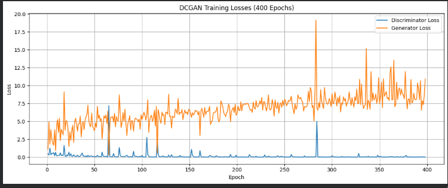

# Experimental DCGAN: Cross-Domain Adversarial Image Generation

A Deep Convolutional Generative Adversarial Network (DCGAN) experiment where the generator and discriminator are trained using different datasets to explore adversarial learning and image generation.

## Overview

This project uses two neural networks:

- **Generator** — takes random latent vectors as input and learns to generate images.
- **Discriminator** — learns to distinguish real images from generated images using a different dataset from the one used to train the generator.

The project explores adversarial learning by training the generator and discriminator on separate datasets, examining how their learning processes interact during training.

## Results

### Generated Images

Add your generated output images in the `results/` folder and update the image paths below.




<!-- If you have multiple output images, add more sections like this:

-->

### Generator and Discriminator Loss

Add your loss graph to the `results/` folder.



## Dataset Setup

This project does not include any datasets. You can use cat and dog images or any other two image datasets of your choice.

**Sources for datasets used in this experiment:**
- **Cat Dataset:** [Cats Faces 64x64 for Generative Models (Kaggle)](https://www.kaggle.com/datasets/spandan2/cats-faces-64x64-for-generative-models)
- **Dog Dataset:** [The DogFaceNet Datasets (Zenodo)](https://zenodo.org/records/12578449)

Before running the notebook, place both datasets in the project directory. Each dataset must contain a subfolder holding the images, as required by `torchvision.datasets.ImageFolder`.

**Expected folder structure:**

```text
DCGAN/
├── dcgan.ipynb
├── cat/
│   └── images/
│       ├── image1.jpg
│       ├── image2.jpg
│       └── ...
├── dog/
│   └── images/
│       ├── image1.jpg
│       ├── image2.jpg
│       └── ...
├── README.md
└── requirements.txt

You can replace `cat` and `dog` with the names of your own datasets. If you use different folder names or place the datasets inside a separate `datasets/` directory, update the dataset paths in the notebook accordingly.

**Important:** Place image files inside the `images/` subfolders rather than directly inside the dataset folders. The notebook uses `ImageFolder` to load images from subdirectories.

The generator and discriminator are trained using separate datasets, so make sure both datasets are available before starting training.

## Technologies Used

- Python
- PyTorch
- torchvision
- NumPy
- Matplotlib

## Running the Notebook

1. Open `dcgan.ipynb` in Google Colab or Jupyter Notebook.
2. Install the required libraries if they are not already available.
3. Upload or mount the cat and dog datasets and update the dataset paths in the notebook if needed.
4. Run the notebook cells in order to train the model and generate images.
